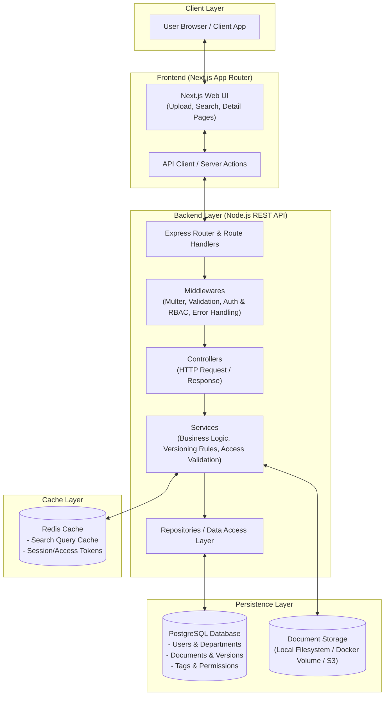
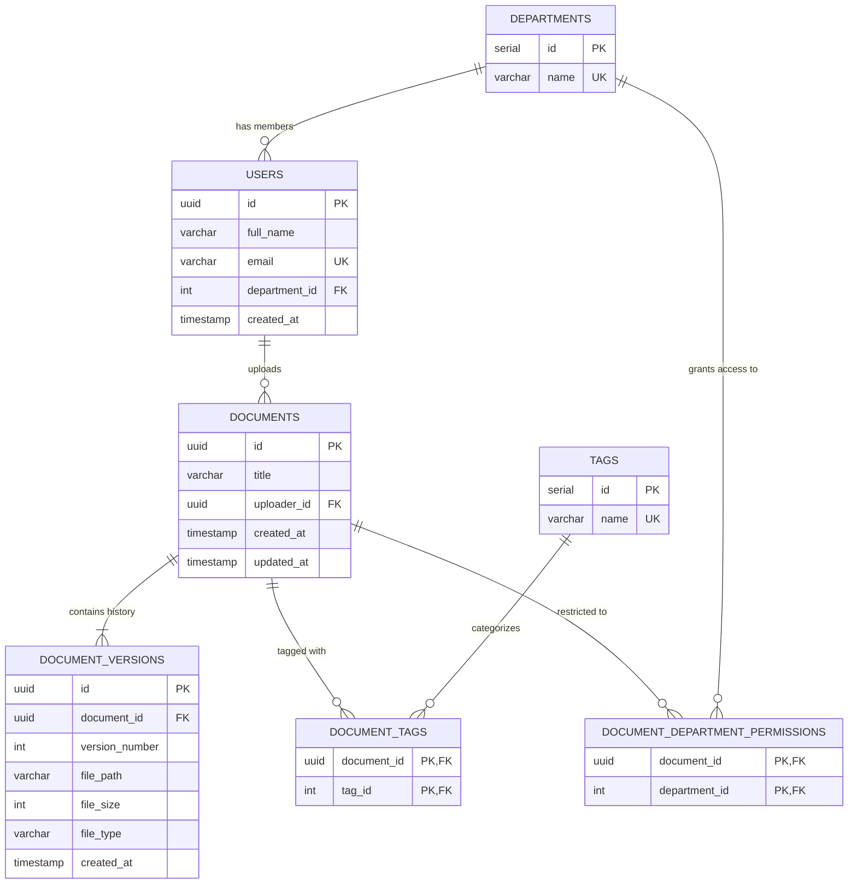

# Corporate Document Repository (POC)

A secure, scalable, and user-friendly Document Repository Proof of Concept (POC) where employees can upload, store, version, and search corporate documents (such as policies, reports, and technical documentation).

---

## Deliverable 1: System Architecture & Design Choices

### 1. High-Level System Architecture Diagram



---

### 2. Design Choices & Rationale

1. **Separation of Concerns (Layered Architecture):**
   - **Routes**: Expose endpoints following REST principles and wire up validation / upload middlewares.
   - **Controllers**: Handle HTTP-specific input/output (status codes, headers, response formatting) without leaking business rules.
   - **Services**: Encapsulate core business logic (e.g., calculating next version number, applying department access rules, orchestrating database transactions with file writes).
   - **Repositories**: Direct data access to PostgreSQL using parameterized queries for SQL injection safety and maintainability.

2. **Immutable Versioning Strategy:**
   - Documents are separated into two concepts: the logical `Document` identity and its immutable `DocumentVersion` entries.
   - When a new version is uploaded, a new record is added with an incremented `version_number` and points to its specific physical file path on the volume.
   - History is never overwritten, guaranteeing full auditability and the ability to download any prior revision.

3. **Storage & Decoupled File Handling:**
   - Raw files are stored on a persistent volume mount (`backend/uploads`) or object storage rather than database BLOBs.
   - The database stores only the sanitized metadata, size, MIME type, and reference path. This keeps the database lean, fast, and backup-friendly.

4. **Multi-Tagging & Department-Level Access Control:**
   - Many-to-many relationship for tags allows flexible categorization (e.g., `Finance`, `Legal`, `Policy`).
   - Many-to-many permissions mapping (`document_department_permissions`) allows documents to be shared strictly across designated departments, enabling fine-grained filtering directly at query time.

5. **Search Performance & Redis Caching:**
   - Indexed database fields (`documents.title`, `documents.uploader_id`, `tags.id`) provide fast relational filtering.
   - Redis sits in front of read-heavy search queries and hot document metadata to reduce database round-trips. Cache keys are invalidated whenever a new document or version is uploaded.

---

## Database Design & Entity Relationship



---

## Project Structure

```text
assessment/
├── database/
│   └── init.sql                          # Database schema, indexes, and seed data
├── docker-compose.yml                    # Starts PostgreSQL and Redis
├── .env.example                          # Root environment variable template
├── .gitignore                            # Standard git ignore rules
├── README.md                             # Architecture, system design & setup guide
│
├── backend/                              # Node.js + TypeScript REST API
│   ├── package.json
│   ├── tsconfig.json
│   ├── .env.example
│   ├── uploads/                          # Local/Volume file storage
│   └── src/
│       ├── config/
│       │   ├── db.ts                     # PostgreSQL connection pool
│       │   └── redis.ts                  # Redis client
│       ├── controllers/
│       │   └── document.controller.ts    # Document request handlers
│       ├── services/
│       │   └── document.service.ts       # Business & versioning logic
│       ├── repositories/
│       │   └── document.repository.ts    # SQL queries & transactions
│       ├── routes/
│       │   ├── index.ts                  # API router root
│       │   └── document.routes.ts        # REST endpoints
│       ├── middlewares/
│       │   ├── upload.middleware.ts      # Multer file upload setup
│       │   ├── validate.middleware.ts    # Request payload validation
│       │   └── error.middleware.ts       # Global error handler
│       ├── types/
│       │   └── document.types.ts         # TypeScript interfaces & DTOs
│       ├── utils/
│       │   └── response.util.ts          # Standard JSON response helpers
│       ├── app.ts                        # Express application configuration
│       └── server.ts                     # Server listener bootstrap
│
└── frontend/                             # Next.js (App Router) + Tailwind CSS
    ├── package.json
    ├── tsconfig.json
    ├── next.config.js
    ├── tailwind.config.ts
    ├── postcss.config.js
    ├── .env.example
    └── src/
        ├── app/
        │   ├── layout.tsx                # App root layout
        │   ├── page.tsx                  # Home landing
        │   └── documents/
        │       ├── page.tsx              # Search & document listing page
        │       ├── upload/
        │       │   └── page.tsx          # Upload document page
        │       └── [id]/
        │           └── page.tsx          # Document detail & versions page
        ├── components/
        │   ├── Navbar.tsx                # Navigation header
        │   ├── DocumentSearch.tsx        # Search bar and filter controls
        │   ├── DocumentUploadForm.tsx    # Upload form with tag selection
        │   ├── DocumentDetail.tsx        # Document metadata & actions
        │   └── VersionHistoryTable.tsx   # Table of historical versions
        ├── lib/
        │   └── api.ts                    # Backend API fetcher client
        └── types/
            └── index.ts                  # Shared UI types & interfaces
```

---

## Setup & Running the Infrastructure

### 1. Start Database & Redis
From the project root:
```bash
docker compose up -d
```
This automatically boots:
- PostgreSQL on port `5432` and applies `database/init.sql`.
- Redis on port `6379`.

### 2. Backend Setup
```bash
cd backend
npm install
cp .env.example .env
npm run dev
```

### 3. Frontend Setup
```bash
cd frontend
npm install
cp .env.example .env.local
npm run dev
```
Access the application at `http://localhost:3000`.

