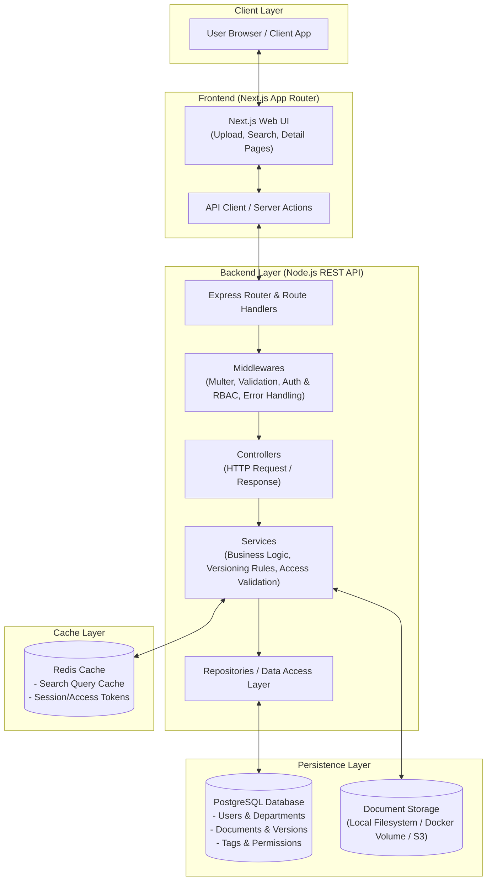
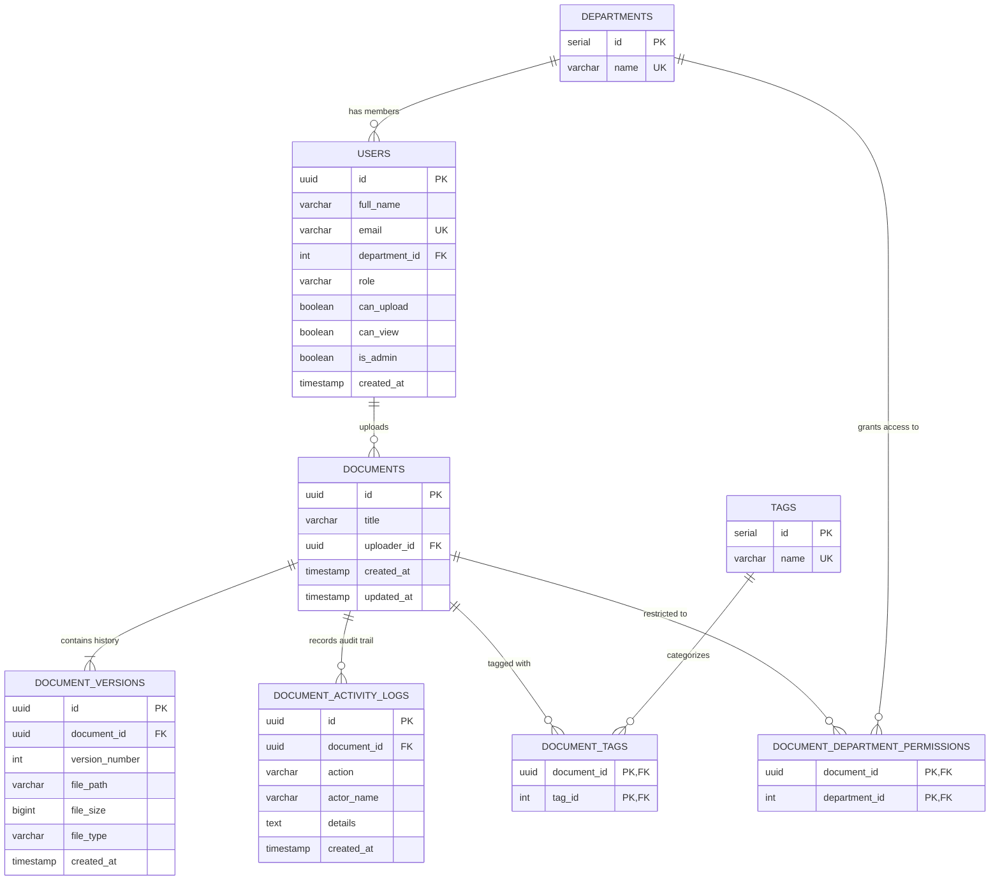

# Corporate Document Repository (POC)

A secure, scalable, and user-friendly Document Repository Proof of Concept (POC) where employees can upload, store, version, and search corporate documents (such as policies, reports, and technical documentation).

> **🎥 Quick Overview About the Project:** [Watch the Project Walkthrough & Demo](https://drive.google.com/file/d/1OWb7VFQ-nmDhIqqpCGpotA6Iucxamdie/view?usp=sharing)

---

## Deliverable 1: System Architecture & Design Choices

### 1. High-Level System Architecture Diagram



---

### 2. Design Choices & Rationale

* **Layered Architecture:** Clear division between HTTP routes, controllers, business services, and database repositories prevents coupling and keeps code testable.
* **Immutable Document Versions & Audit Trail:** Logical documents, physical file versions, and security audit events are separated (`documents`, `document_versions`, and `document_activity_logs`). New revisions increment version numbers without overwriting past files, preserving a complete chronological compliance history.
* **Decoupled File Storage:** Files are stored on a persistent volume mount while PostgreSQL only stores paths, sizes, and MIME types, keeping database backups lean and fast.
* **Fine-Grained Access Control & Authorization:** Many-to-many department permissions restrict confidential files directly at SQL query time, while destructive or mutating actions (editing metadata/tags, deleting documents or specific revisions) require company password authorization (`EEMW`).
* **Smart Caching:** Redis caches search queries and hot documents using non-blocking `SCAN` iteration, instantly invalidated upon new uploads, edits, or revisions.

---

## Key Features

* **In-App Document Preview Modal:** Preview PDFs (`<iframe>`), images (with interactive zoom controls), and text/code/CSV/JSON files inline without switching browser tabs, complete with a live revision switcher (`v1`, `v2`, etc.).
* **Compliance Activity & Audit Log:** Tracks and displays a live chronological timeline of `UPLOAD_INITIAL`, `UPLOAD_VERSION`, `EDIT_METADATA`, `DELETE_VERSION`, `VIEW`, and `DOWNLOAD` events per document.
* **Storage Analytics & Disk Usage Widget:** Live storage meter (`X MB / 100 MB`) with expandable breakdowns by department and file format across all revisions.
* **Multi-Folder Virtual Tag Filtering:** Select multiple virtual folders simultaneously with full browser Back/Forward history integration, combined with real-time search across titles, tags, and uploaders.
* **Role-Based Access Control & Admin User Management:** Switch between employees with distinct permission tiers (`Upload & View`, `View Only`, `No Access`) or unlock the **EEMW System Admin** account to grant/revoke employee permissions live.
* **Universal Company Authorization Password (`EEMW`):** All privileged and destructive actions use the company password **`EEMW`**:
  * Switching to the **EEMW Admin** account and modifying employee access levels (`Upload & View`, `View Only`, `No Access`).
  * Editing any document's title and category tags.
  * Deleting an entire document or removing specific historical revisions.

---

## Database Design & Entity Relationship



---

## Project Structure

```text
DocDrop/
├── database/
│   └── init.sql                          # Database schema, indexes, audit logs, and seed data
├── docker-compose.yml                    # Starts PostgreSQL and Redis containers
├── .gitignore                            # Standard git ignore rules
├── README.md                             # Architecture, system design & setup guide
│
├── backend/                              # Node.js + Express REST API (TypeScript)
│   ├── package.json
│   ├── tsconfig.json
│   ├── uploads/                          # Local/Volume physical file storage
│   └── src/
│       ├── config/
│       │   ├── db.ts                     # PostgreSQL connection pool & schema auto-migration
│       │   └── redis.ts                  # Redis client with non-blocking SCAN caching
│       ├── controllers/
│       │   └── document.controller.ts    # Request handlers (CRUD, preview, download, analytics)
│       ├── services/
│       │   └── document.service.ts       # Business rules, versioning, EEMW auth & cache
│       ├── repositories/
│       │   └── document.repository.ts    # SQL queries, transactions, audit logs & analytics
│       ├── routes/
│       │   ├── index.ts                  # API router aggregation
│       │   └── document.routes.ts        # REST endpoints definition
│       ├── middlewares/
│       │   ├── upload.middleware.ts      # Multer file storage & mime configuration
│       │   └── error.middleware.ts       # Central error handler (Postgres & Multer codes)
│       ├── types/
│       │   └── document.types.ts         # TypeScript interfaces & DTOs
│       ├── utils/
│       │   └── response.util.ts          # Standard JSON API response formatters
│       ├── app.ts                        # Express app setup & middleware pipeline
│       └── server.ts                     # HTTP listener bootstrap
│
└── frontend/                             # Next.js (App Router) + Tailwind CSS UI
    ├── package.json
    ├── tsconfig.json
    ├── next.config.js
    ├── tailwind.config.ts
    ├── postcss.config.js
    └── src/
        ├── app/
        │   ├── globals.css               # Global Tailwind CSS directives
        │   ├── layout.tsx                # Root layout & page metadata
        │   └── page.tsx                  # Main DocDrop dashboard (analytics, folders, grid/list)
        ├── components/
        │   ├── Navbar.tsx                # Brand, search bar, active tag pills, sort & user switcher
        │   ├── AdminAccessModal.tsx      # Dedicated System Admin modal to manage employee permissions
        │   ├── StorageAnalyticsWidget.tsx# Disk usage meter with department & file-type breakdown
        │   ├── FolderCard.tsx            # Multi-select virtual folder cards for category tags
        │   ├── DocumentCard.tsx          # File card with type badge, in-app preview & download
        │   ├── DocumentListView.tsx      # Table alternative for file listing
        │   ├── DocumentUploadModal.tsx   # Upload modal with custom tag creation & access control
        │   ├── DocumentDetailModal.tsx   # Metadata editor (EEMW), version history & audit log tabs
        │   ├── DocumentPreviewModal.tsx  # In-app PDF/Image/Text viewer with live version switcher
        │   ├── VersionHistoryTable.tsx   # Revision history table with preview, download & delete
        │   └── UploadQueue.tsx           # Floating bottom-right upload progress widget
        ├── lib/
        │   └── api.ts                    # REST client & fetcher helpers
        └── types/
            └── index.ts                  # Shared frontend UI types
```

---

## Setup & Running the Infrastructure

### 1. Start Database & Redis
Ensure Docker Desktop is running, then from the project root:
```bash
docker-compose up -d
```
This automatically boots:
- PostgreSQL on port `5433` and applies `database/init.sql`.
- Redis on port `6379`.

### 2. Backend Setup
```bash
cd backend
npm install
npm run dev
```
API runs on `http://localhost:5000` (Health check: `http://localhost:5000/api/health`).

### 3. Frontend Setup
```bash
cd frontend
npm install
npm run dev
```
Open **`http://localhost:3000`** in your browser.

